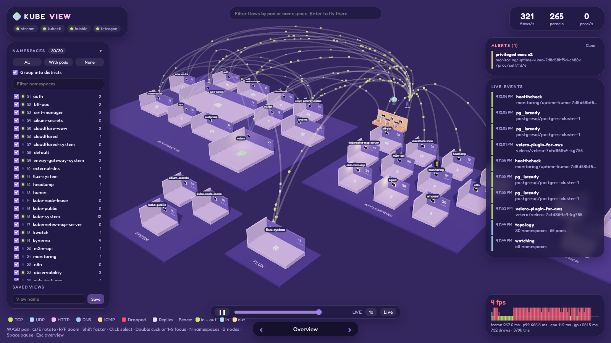
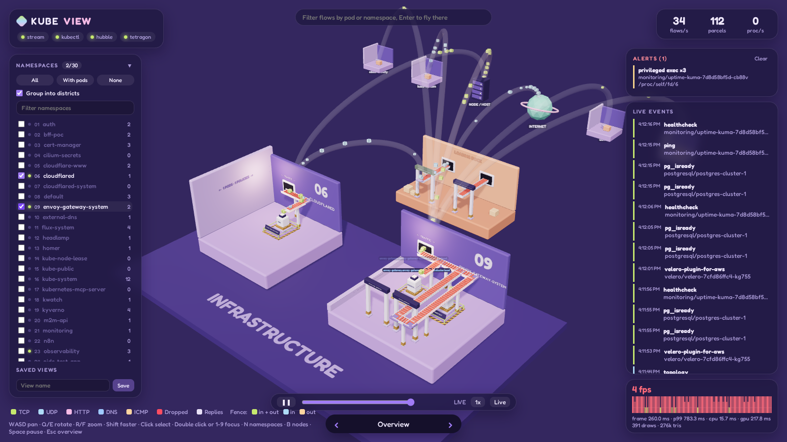

# 3D Kube View

A live, explorable 3D diorama of a Kubernetes cluster built with three.js. Namespaces are rooms, pods are machines, and real network flows from Cilium Hubble travel as parcels on conveyor belts. Tetragon process events light up the machines as they happen.





## How it maps

| Cluster | Scene |
| --- | --- |
| Flux path | District plate on the ground |
| Namespace | Diorama room with its number and name on the wall. Far away it collapses to one block per pod |
| Node | Plate in the node yard with its pods |
| Workload | Hazard striped pad with a name sign, fenced when network policies restrict it |
| Pod | Machine with a lamp, color shows status. Rises on create, sinks on delete, shakes on restart |
| Service | Gate arch, service traffic rides through it |
| Flow | Parcel on a belt (inside a room) or through a tube (between rooms) |
| Entry point (LoadBalancer, Gateway, tunnel) | Bay of the loading dock, Internet traffic passes through it |
| Internet, node/host, hidden namespace | Floating portals |
| Tetragon exec / kprobe | Lamp flash and floating process name |
| Tetragon TracingPolicy event, privileged exec | Beacon on the machine and an entry in the alert feed |
| DNS, HTTP, drop reason | Floating tags |

Parcel colors: TCP lime, UDP blue, HTTP pink, DNS blue, ICMP peach, dropped red (falls off the belt). Click a legend entry to hide that traffic, including replies. Belts and tubes warm up with throughput. The panel at the bottom right shows fps, frame time, CPU and GPU time, draw calls and triangles.

## Requirements

- Node.js 20+
- `kubectl` with a working context
- Cilium with Hubble enabled, Tetragon (optional, process events)

All data comes from `kubectl`: `get` for topology, `exec` into the Cilium agents for `hubble observe` and into the Tetragon pods for `tetra getevents`. Nothing is installed into the cluster. While the app runs, one `hubble observe` and one `tetra getevents` run per agent pod, and they end when the app stops.

## Run

```bash
./start.sh                                   # build and serve on http://127.0.0.1:8080
./start.sh dev                               # Vite with hot reload on http://127.0.0.1:5173
NAMESPACES=auth,whoami ./start.sh            # optional allowlist, default is all namespaces
KUBE_CONTEXT=my-ctx PORT=9000 ./start.sh
```

## Controls

| Input | Action |
| --- | --- |
| `WASD` / arrows | Pan |
| `Q` / `E` | Rotate |
| `R` / `F`, mouse wheel | Zoom |
| `Shift` | Faster |
| Left / right drag | Orbit / pan |
| Click | Show details |
| Double click, `1`-`9` | Fly to object or namespace |
| `N` | Toggle namespace panel |
| `B` | Toggle node yard |
| `Space` | Pause or resume, the slider above the nav replays the last 5 minutes |
| `Esc` | Back to overview |

The namespace panel lets you show all namespaces or toggle a selection (presets, search, live activity dots, saved views, districts from Flux paths). The selection is stored in the browser, toggling keeps the traffic that is already moving, and the server only streams what at least one browser shows.

## Project layout

```
server/   Node backend (no dependencies): kubectl wrappers, topology, Hubble and Tetragon streams, SSE hub
src/      three.js frontend
  core/     renderer, camera rig, picking, light pool
  objects/  rooms, pods, gates, belts, tubes, portals
  scene/    campus layout and endpoint resolution
  traffic/  parcels, routing, Tetragon effects
  ui/       HUD and namespace panel
  theme/    palette, materials, canvas textures
scripts/  headless browser setup and screenshots
```

## Screenshots

A local headless Chromium (in `.browser/`, gitignored) renders the app for visual checks:

```bash
npm run setup:browser
npm run screenshot -- http://127.0.0.1:8080/
```

## Documentation

See [docs/](docs/README.md) for design, architecture, decisions and known limits.
